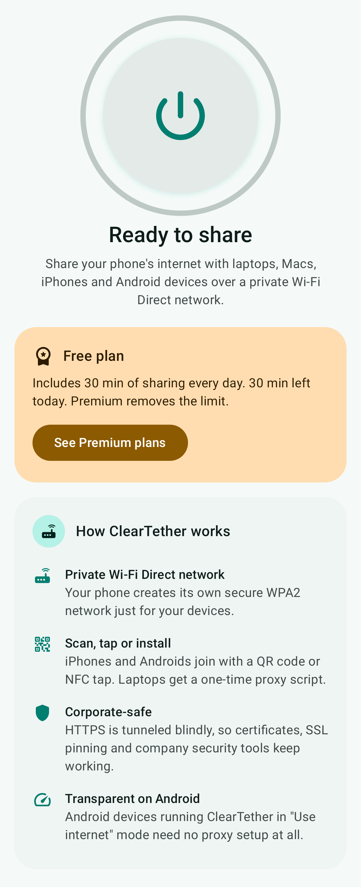
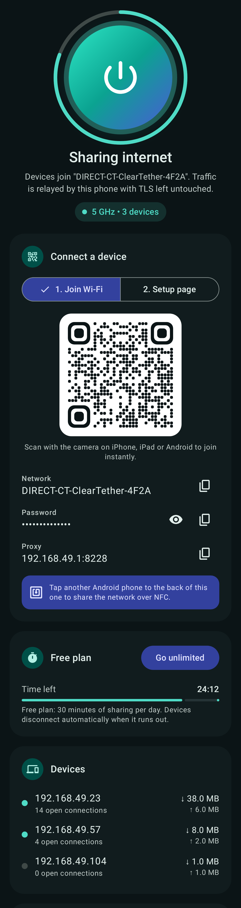
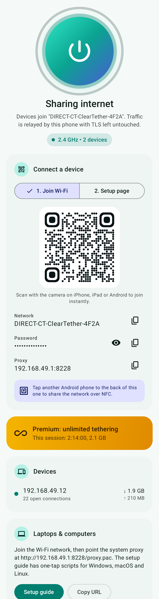
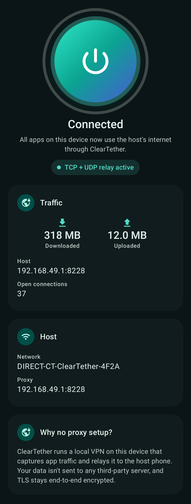
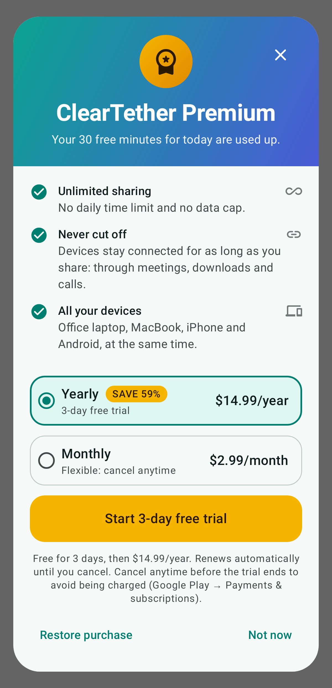

# ClearTether

**Share your phone's mobile data with your office laptop, MacBook, iPhone and other Android
devices over Wi-Fi Direct. No hotspot plan, no root.**

<p align="center">
  
  
  
  
  
</p>

## Features

- **One switch to share.** ClearTether creates a private WPA2 Wi-Fi Direct network and a
  relay on the phone. Carrier hotspot provisioning isn't used.
- **Join in seconds.** Scan a QR code (iPhone/Android camera), tap phones together (NFC), or
  type the stable network name and password once.
- **Zero-config for Android clients.** Install ClearTether on the other phone and pick *Use
  internet*: a local VPN routes every app (TCP and UDP) through the host, with no proxy settings.
- **Laptops & Macs.** A built-in setup page (`http://192.168.49.1:8228`) serves a PAC
  auto-config URL, a one-tap Apple configuration profile (Wi-Fi + proxy together) and Windows,
  macOS and Linux one-liners.
- **Corporate-safe.** HTTPS is tunneled blindly (HTTP CONNECT), so certificates, SSL pinning
  and company security agents keep working.
- **Captive-portal assist.** OS connectivity checks are answered instantly, so devices show
  "Connected".
- **Freemium.** Free plan: 30 minutes of sharing per day, then devices disconnect automatically.
  **Premium** (monthly or yearly subscription via Google Play Billing, free trial on yearly)
  unlocks unlimited sharing.

> **How "transparent" works without root.** A non-rooted phone can't forward other devices'
> packets, and a `VpnService` only sees the phone's *own* apps. So ClearTether relays traffic
> through a proxy on the host, and does the transparent capture on the *client* with its own
> VPN. Laptops and iPhones need a one-time proxy setting, which the setup page automates. Full
> details: [`docs/ARCHITECTURE.md`](docs/ARCHITECTURE.md).

## Project layout

```
app/src/main/java/com/cleartether/app/
├── core/                 pure Kotlin, JVM-tested
│   ├── net/              AsyncSocket (NIO.2 + coroutines), CIDR/ACL policy, upstream connector
│   ├── proxy/            TetherProxyEngine, captive portal, setup site/PAC/profile, SOCKS UDP relay
│   ├── session/          TetherSessionManager (free-tier metering)
│   ├── tun/              user-space TCP/IP stack for Client mode (packets, TcpFlow, DNS, UDP)
│   └── share/            Wi-Fi QR, NDEF, Wi-Fi Simple Config, Type 4 tag emulation
├── wifi/                 WifiDirectManager, ClientWifiConnector
├── service/              TetherForegroundService, TransparentTetherVpnService, NfcShareService
├── billing/              BillingRepository, PurchaseVerifier
├── data/                 DataStore settings, runtime state
└── ui/                   Jetpack Compose (Material 3) screens
tools/tun-e2e/            Linux TUN bridge for end-to-end tests against the real kernel TCP stack
```

## Build

Requirements: JDK 17+, Android SDK with **platform 37** (compileSdk 37, targetSdk 36, minSdk 29).

```bash
echo "sdk.dir=/path/to/Android/sdk" > local.properties
./gradlew :app:assembleDebug          # debug APK (applicationId com.cleartether.app.debug)
./gradlew :app:assembleRelease        # minified release APK (R8)
./gradlew :app:bundleRelease          # AAB for Google Play
```

Release signing reads `keystore.properties` (git-ignored) or environment variables:
`CLEARTETHER_KEYSTORE`, `CLEARTETHER_KEYSTORE_PASSWORD`, `CLEARTETHER_KEY_ALIAS`,
`CLEARTETHER_KEY_PASSWORD`.

## Tests

```bash
./gradlew :app:testDebugUnitTest :app:lintDebug
```

- Proxy engine: CONNECT tunnelling (2 MiB, SHA-256 verified), HTTP forwarding and header
  hygiene, captive-portal answers, PAC/profile/portal, DoH endpoint, SOCKS4a/SOCKS5 including UDP
  ASSOCIATE, ACLs, pause/resume, 64 concurrent tunnels.
- Session manager (virtual time): 30-minute daily allowance, optional data cap, carry-over,
  midnight reset, mid-session upgrade. Billing plan maths (trial length, yearly savings).
- Packet codecs, DNS cache/failover/truncation, NFC Type 4 APDU flow, Wi-Fi QR escaping.
- **Kernel end-to-end** (`KernelTunE2ETest`, runs as root on Linux with `/dev/net/tun`,
  `ip` and `python3`; skipped otherwise): real kernel TCP → TUN → user-space stack → proxy →
  server. Covers 16 MiB full-duplex transfers, 40 parallel connections, server-first close,
  zero-window flow control and refusal latency. Add `CT_TUN_DROP=0.02` to inject 2% packet loss.
- Screenshots (Robolectric + Roborazzi):
  `./gradlew :app:testDebugUnitTest -Pscreenshots --tests '*ScreenshotTest*'` → `docs/screenshots/`.

CI: `.github/workflows/cleartether-android.yml` builds, lints, tests and uploads the APK.

## Publishing (Google Play)

Everything for the store is in [`docs/play-store/`](docs/play-store):
[step-by-step guide](docs/play-store/PUBLISHING.md), [listing text](docs/play-store/listing.md),
[graphics](docs/play-store/graphics) and the [pricing recommendation](docs/play-store/PRICING.md)
(monthly $2.99 / ₹99, yearly $14.99 / ₹499 with a 3-day trial). After the first manual upload,
`.github/workflows/cleartether-release.yml` builds, signs and uploads releases in one click.

Play Console catalogue: subscription `cleartether_premium` with base plans `monthly` and
`yearly` (plus an optional one-time `cleartether_premium_lifetime`). Tune the free plan in
`FreeTierPolicy` (`core/session/TetherSessionManager.kt`). Regenerate store graphics with
`./gradlew :app:testDebugUnitTest -Pscreenshots --tests '*ScreenshotTest*' && python3 tools/play-store/make_graphics.py`.
