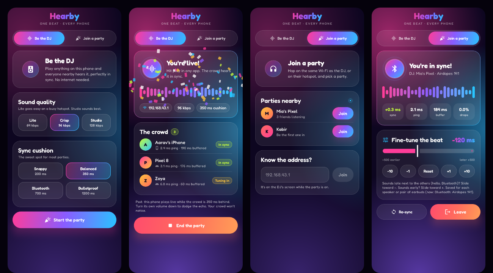
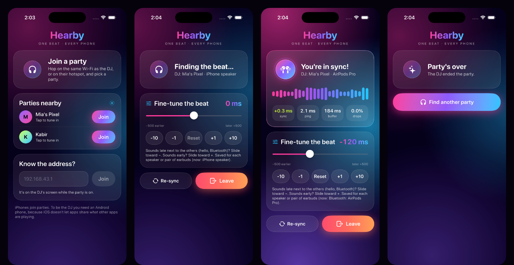

# Hearby

One Android phone shares whatever it is playing (YouTube, a movie, music) with nearby phones over
the local Wi-Fi or its own hotspot. Every listener, Android or iPhone, plays it at the same instant,
through its speaker or its own Bluetooth earbuds. No internet, no accounts, no paid SDKs.

| | Host (shares audio) | Listener |
|---|---|---|
| Android 10+ (Kotlin, Jetpack Compose) | yes | yes |
| iOS 15+ (Swift, SwiftUI) | no (iOS cannot capture other apps' audio) | yes |

```
hearby/
  android/   Android Studio project: host + listener app
  ios/       Xcode project: listener app, plus a Swift package for testing the sync core
  docs/      PROTOCOL.md: byte-level packet spec and test vectors
  tools/     hearby_probe.py: a Python peer for debugging (join a host, or act as one)
  store/     Play Store icon and feature graphic
```

In the apps, the phone sharing its audio is "the DJ", its session is "the party", and listeners are
"the crowd". The code and the protocol keep the plainer words host and listener.

```
```

## Look and feel

Hearby is used at parties, so it looks like one: a dark stage with slow-moving pools of neon light,
frosted glass panels, chunky gradient buttons that squish when pressed, a visualizer that moves with
the music actually being played (and settles into a row of dots when it is silent), confetti when
someone joins or when a phone locks into sync, and wording to match ("Be the DJ", "The crowd",
"Finding the beat…").

Android (DJ setup, a live party, finding a party, playing in sync):



iPhone (finding a party, syncing, playing in sync, party over):



The design system lives in one file per platform, `android/.../ui/PartyKit.kt` and
`ios/Hearby/PartyKit.swift`: the palette, the animated backdrop, buttons, visualizer, confetti. The
type is Fredoka on Android (bundled, SIL Open Font License, see `android/licenses/FONTS.md`) and SF
Rounded on iOS. The app is always dark, and looping animations stop when the system's reduce-motion
or animation-off setting is on.

Screens can be rendered without a phone:

- Android: `./gradlew testDebugUnitTest --tests '*ScreenshotTest*'` writes every screen, with sample
  data, to `app/build/outputs/roborazzi/`.
- iOS: launch a debug build with `-demo join`, `-demo playing`, `-demo syncing` or `-demo ended` to
  show a screen with sample data and no network. CI does this in the simulator.

CI publishes both sets as downloadable artifacts (`hearby-android-screens`, `hearby-ios-screens`) on
every run. The images above come from those renders.

## How it works

```
 HOST  (Android)                                                     AudioCaptureAndOpusService.kt
 ┌──────────────────────────────────────────────────────────────────────────────────────────────┐
 │ YouTube / any app                                                                            │
 │      │ playback (usage MEDIA / GAME / UNKNOWN)                                               │
 │      ▼                                                                                       │
 │ MediaProjection + AudioPlaybackCapture ──▶ AudioRecord   48 kHz · stereo · PCM16             │
 │                                               │ capture thread: read exactly 20 ms (960 fr.) │
 │                                               ▼                                              │
 │                            TimestampSmoother: host monotonic clock, jitter filtered          │
 │                                               ▼                                              │
 │                            MediaCodec "audio/opus" encoder: 1 packet per 20 ms               │
 │                                               ▼                                              │
 │                  ┌ 'H''B' ver type │ seq u32 │ timestamp u64 │ Opus payload ┐  16 B header   │
 │                  └──────────────────────────────────────────────────────────┘                │
 │                                               │ UDP unicast to each listener (DSCP EF)       │
 │ control thread, same socket:  JOIN · SYNC (NTP + keep-alive) · LEAVE · DISCOVER              │
 │ mDNS:  NsdManager registers  _hearby._udp                                                    │
 └───────────────────────────────────────────────┼──────────────────────────────────────────────┘
                                                 │  Wi-Fi LAN or the host's hotspot, port 47800
                 ┌───────────────────────────────┴───────────────────────────────┐
                 ▼                                                               ▼
 LISTENER (Android)  AndroidSyncReceiver.kt            LISTENER (iOS)  IOSSyncReceiver.swift
 ┌──────────────────────────────────────────┐          ┌──────────────────────────────────────────┐
 │ DatagramSocket (bound to Wi-Fi)          │          │ NWConnection (UDP, no cellular)          │
 │   ├─ SYNC_RESP ─▶ ClockSync              │          │   ├─ SYNC_RESP ─▶ ClockSync              │
 │   └─ AUDIO ─────▶ JitterBuffer           │          │   └─ AUDIO ─────▶ JitterBuffer           │
 │ playout thread                           │          │ playout thread                           │
 │   PlayoutEngine: which frame is due now? │  shared  │   PlayoutEngine: which frame is due now? │
 │   ├─ MediaCodec Opus decode              │   core   │   ├─ AudioToolbox Opus decode            │
 │   ├─ Resampler (±0.5 % drift correction) │ ◀──────▶ │   ├─ Resampler (±0.5 % drift correction) │
 │   └─ AudioTrack.write (blocking)         │  logic   │   └─ ring buffer ─▶ AVAudioSourceNode    │
 │ AudioTrack.getTimestamp(): when do       │          │ render host time + outputLatency: when   │
 │ frames really reach the speaker / BT?    │          │ do frames really reach speaker / AirPods?│
 └──────────────────────────────────────────┘          └──────────────────────────────────────────┘

 Every listener plays the first sample of a packet at:
     (packet timestamp − clock offset)  +  host playout delay  +  its own slider offset
```

### The pieces that make it stay in sync

1. **One timeline.** The host stamps every 20 ms frame with the time it was captured on the host's
   monotonic clock. Timestamps come from the real capture cadence, smoothed by a first-order loop,
   not from counting samples, so they follow the capture clock's drift.
2. **Clock offset per listener.** An NTP-style exchange (burst of 8 on join, then 1/s) estimates
   `host clock − local clock`. Of the last 12 exchanges the one with the shortest round trip is
   trusted, because its error bound (half the round trip) is the smallest.
3. **A common playout delay.** The host picks how far behind live everyone plays (200 / 350 / 700 /
   1200 ms) and tells listeners in JOIN_ACK and every SYNC_RESP. It has to cover capture + encode
   (about 27 ms), the network, the listener's audio buffer and its output latency.
4. **Closed-loop playout.** Before each frame the listener asks its audio output when the next
   written sample will actually be *heard* (`AudioTrack.getTimestamp()` on Android; render-cycle
   host time + `AVAudioSession.outputLatency` on iOS) and compares that with when the frame is
   *due*. The error steers a 16-tap polyphase sinc resampler by at most ±0.5 %, which absorbs the
   drift between the host's capture clock, the clock estimate and the listener's DAC. Errors over
   30 ms, a host timeline jump, or a setting change trigger a sample-exact re-align instead.
5. **Jitter and loss.** Packets wait, still encoded, in a sequence-indexed buffer until the last
   moment. A missing frame is concealed with a 5 ms reversed-tail fade-out and a fade-in on the next
   good frame (the platform decoders expose no Opus PLC), so loss sounds like a tiny dip, not a click.
6. **Honest fallback.** If a device cannot meet the delay (Bluetooth latency larger than the buffer,
   or a big negative slider value), it plays later by exactly what is missing, shows that number,
   and reclaims it automatically when headroom returns.
7. **The manual slider.** Phones cannot measure what happens inside Bluetooth earbuds. The −500 …
   +500 ms slider is added to that device's target time and remembered per output device.

`PlayoutEngine`, `ClockSync`, `JitterBuffer`, `Resampler` and the packet codec exist twice, in Kotlin
and Swift, deliberately line for line the same and with no platform imports.

## Building

### Android

Requirements: JDK 17 or newer, Android SDK platform 36. Open `android/` in Android Studio, or:

```bash
cd android
./gradlew testDebugUnitTest      # protocol vectors, clock sync, resampler, playout simulations
./gradlew assembleDebug          # app/build/outputs/apk/debug/app-debug.apk
```

Release builds are signed from `android/keystore.properties`, which is git-ignored:

```properties
storeFile=/path/to/upload-keystore.jks
storePassword=...
keyAlias=...
keyPassword=...
```

```bash
./gradlew bundleRelease          # app/build/outputs/bundle/release/app-release.aab  (upload this to Play)
./gradlew assembleRelease        # app/build/outputs/apk/release/app-release.apk     (sideloading)
```

### iOS

Requirements: Xcode 15 or newer.

1. Open `ios/Hearby.xcodeproj`.
2. Select the Hearby target › Signing & Capabilities, choose your team, and change the bundle
   identifier if you like.
3. Run on a real iPhone. The simulator works for the UI, but audio timing there is meaningless.

The sync core can be tested without a device: `cd ios && swift test`.

### Debugging with a laptop

`tools/hearby_probe.py` needs only Python 3 and speaks the same protocol:

```bash
python3 tools/hearby_probe.py listen 192.168.43.1   # join a host, print packet and clock statistics
python3 tools/hearby_probe.py host                  # be a host that streams Opus silence
python3 tools/hearby_probe.py discover              # find hosts by broadcast
```

Opus decoding uses AudioToolbox's built-in `kAudioFormatOpus` through `AVAudioConverter`, so there
are no package dependencies.

## Using it

1. **Host:** open Hearby › *Share audio* › *Start sharing*. Allow the Microphone permission (Android
   guards playback capture with it; the microphone itself is never opened) and accept Android's
   capture dialog. Then start playback in any app.
2. **Listeners:** join the same Wi-Fi as the host, or the host's hotspot. Open Hearby › *Listen* and
   tap the host. If it does not appear, type the address shown on the host's screen.
3. If one device sounds late next to the others, move its **Sync offset** slider toward −.
   Bluetooth earbuds and speakers usually need somewhere between −50 and −250 ms.

The host itself keeps playing live while listeners are one playout delay behind. Turn the host's
media volume down to avoid an echo in the same room; captured audio is taken before the volume
control, so listeners are not affected.

## Limitations and edge cases

**Capture (Android host)**

- Apps decide whether they may be captured. Android only captures playback with usage `MEDIA`,
  `GAME` or `UNKNOWN` from apps that allow it (`allowAudioPlaybackCapture`, the default for apps
  targeting Android 10+). YouTube, Chrome and most players allow it. **Netflix, Prime Video,
  Disney+, Spotify and other DRM or opted-out apps deliver silence**, and phone/VoIP call audio is
  never capturable. Hearby shows a hint when it has captured only silence for a few seconds.
- MediaProjection consent is needed for every session; Android does not let an app remember it.
- **Android 15 QPR1 and later stop MediaProjection when the device is locked.** Hosting therefore
  needs the screen on and unlocked on those versions (playing a video keeps it on). Android 14 and
  later also show a status-bar chip that ends the capture when tapped. Hearby reports both.
- The host is not delay-compensated: it plays live, listeners play one playout delay later.

**Sync accuracy**

- Between wired or speaker listeners, the remaining error is the clock estimate (usually well under
  a millisecond on a quiet LAN) plus each phone's own output-latency reporting.
- Bluetooth adds 100 to 300 ms that the phone only partly knows. Use the slider; it is saved per
  output device. AirPlay adds about two seconds and will not fit any playout delay.
- A listener whose total latency exceeds the host's playout delay plays late by the shown amount.
  Pick a larger sync buffer on the host. *Low delay* (200 ms) suits speaker or wired listeners only.
- Video on the host's screen leads the listeners' audio by the playout delay. That is inherent to
  the design: the host cannot delay another app's video.

**Network**

- Client isolation ("AP isolation", common on guest and public Wi-Fi) blocks device-to-device
  traffic entirely. Use the host's hotspot instead.
- A hotspot is usually not the listener's default network (mobile data stays the default). The
  Android listener binds its sockets to the Wi-Fi network explicitly for that reason.
- No encryption or authentication in protocol v1: anyone on the same network can join.
- Each listener costs roughly 85 to 150 kbit/s depending on quality. A phone hotspot is comfortable
  with about 8 to 10 listeners.

**iOS**

- Listener only. Apple offers no API for capturing other apps' audio.
- **Local Network permission.** iOS shows a one-time prompt the first time the app browses for hosts
  (text from `NSLocalNetworkUsageDescription`). If the user declines, nothing is found and the app
  says so; it is re-enabled under Settings › Privacy & Security › Local Network. The Bonjour type
  must also be listed in `NSBonjourServices`, which it is.
- Broadcast discovery is not used on iOS (it needs Apple's multicast entitlement); iOS relies on
  Bonjour plus manual address entry.
- Background playback needs the `audio` background mode, which is set. With the screen locked iOS
  may switch to much larger audio buffers; the listener adapts its queue depth, which can require a
  larger playout delay.

## Publishing on Google Play

Play accepts new apps as an **App Bundle** (`.aab`), not an APK. Besides uploading the bundle:

- `applicationId` is `io.github.ugoyel.hearby`. It can never be changed after the first upload, so
  change it now in `android/app/build.gradle.kts` if you want a different one.
- Enrol in Play App Signing and keep the upload keystore and its passwords somewhere safe.
- Declare the two foreground service types in Play Console (App content › Foreground service
  permissions): `mediaProjection` (capturing device audio to share it) and `mediaPlayback`
  (playing the shared audio in the background). Play asks for a short video of each.
- `RECORD_AUDIO` requires a privacy policy URL and a Data safety form. Hearby collects nothing and
  sends audio only to devices on the local network, which is what the form should say.
- Target API level is 36.

## Verification status

| Area | How it was checked | Result |
|---|---|---|
| Wire format, Android ↔ iOS | The same hex vectors asserted by Kotlin and Swift unit tests; a third implementation in Python (`tools/hearby_probe.py`) interoperates with the Android app | Pass |
| Clock sync, jitter buffer, resampler | Unit tests on both platforms | Pass |
| Playout engine | Simulations with clock drift, DAC drift, jitter, 3 % loss, delay spikes, host pauses, slider changes and over-budget latency, in Kotlin and in Swift | Sync error stays under 1.5 ms |
| Android build | Unit tests, lint, signed and 16 KB-aligned release build; also built on a clean GitHub runner | Pass |
| iOS build | `swift test` and an `xcodebuild` simulator build on a macOS runner | Pass |
| Screen design | Every Android screen rendered on the JVM with sample data; every iOS screen screenshotted in the iOS Simulator through the demo mode | Reviewed by eye |
| Android host, on an Android 14 emulator | Release APK (1.1.0, party UI): capture consent, `mediaProjection` foreground service, capture of a tone played by another process, Opus at the configured 96 kbit/s in 20 ms packets, received by the Python listener with no loss; mDNS registration accepted; clean stop | Pass |
| Android listener, on an Android 14 emulator | Release APK (1.1.0, party UI): joined the Python host, clock sync, MediaCodec Opus decode, AudioTrack playout reaching "Playing in sync", offset controls and per-output memory, leave | Pass |

**Not verified yet, and needed before a store release:**

- Anything on physical phones. The emulator had no hardware acceleration and its audio device ran
  slower than real time, so it shows that the pipelines work, not how tightly they sync.
- Real Wi-Fi and hotspot behaviour, including discovery across devices.
- Bluetooth outputs and how well each phone reports its own output latency.
- The iOS app at runtime. It compiles and its sync core passes the same tests as Android, but the
  AudioToolbox Opus decoder and AVAudioEngine timing have not been exercised on a device.

`.github/workflows/hearby.yml` runs the Android and iOS builds and tests on every change under
`hearby/`.
